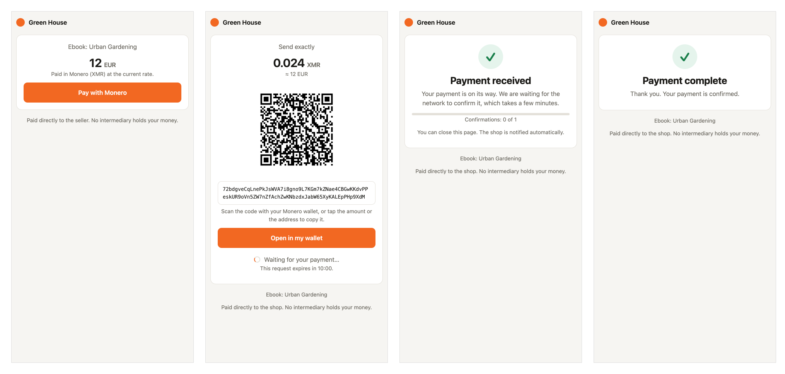
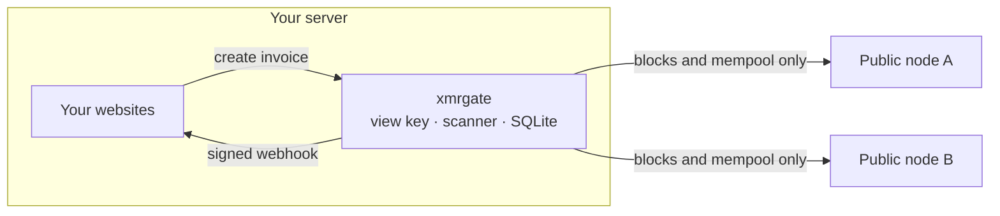

# xmrgate

[](https://github.com/nowi333/xmrgate/actions/workflows/ci.yml)
[](LICENSE)

**A Monero payment gateway for any website.** WooCommerce, a custom shop, a single "pay"
link on a static page: they all get paid straight into your own wallet.

You give xmrgate two things from your wallet, your address and your secret view key. There is
no Monero node to run, nothing to sync, no account to open and no fee.



- **One small program.** About 10 MB on disk and 12 MB of memory. It does not download the
  blockchain.
- **One setup screen.** Paste your address and view key, choose a password.
- **Your money never passes through xmrgate.** It can see incoming payments and nothing else:
  it does not have your spend key and never asks for it.
- **Your view key stays on your server.** Public nodes only serve public blocks. They never
  see your key, your addresses or your payments.
- **Instant feedback.** Customers see "Payment received" seconds after paying, before the
  payment is even confirmed.

## Works with

| Your site | How | Code needed |
|---|---|---|
| **WooCommerce** | Plugin, downloadable from the dashboard | None |
| **Any page, email or profile** | Payment buttons: fixed-price links | None |
| **One customer** | One-time payment links | None |
| **PrestaShop, custom shops, apps…** | Small HTTP API with signed webhooks | A few lines, with tested PHP, Node.js and Python examples |

One gateway serves as many websites as you like. Each has its own secret key and only sees
its own payments.

## Try it without funds

```bash
cargo run --example demo
```

A full gateway on a simulated chain, with sample payments in every state. Open the dashboard
it prints (password `demo-password`) and the payment pages to see every screen.

## Get started

**[Read the user guide](docs/guide.md)**: installation, setup, and every screen, with pictures.

The short version, on a server with Docker and a domain name pointed at it:

```bash
XMRGATE_DOMAIN=pay.example.com docker compose up -d
```

```bash
docker compose logs xmrgate
```

Open the setup address printed in the log, with your domain in place of `YOUR-DOMAIN`.

Without Docker:

```bash
cargo build --release
```

```bash
./target/release/xmrgate
```

| Option | Environment variable | Default |
|---|---|---|
| `--listen <addr>` | `XMRGATE_LISTEN` | `127.0.0.1:3080` |
| `--data <dir>` | `XMRGATE_DATA` | `./xmrgate-data` |
| | `XMRGATE_SETUP_TOKEN` | random, printed at first start |
| `--reset-password` | | choose a new dashboard password, then exit |

## For developers

Three steps, in any language:

```bash
curl https://pay.example.com/api/v1/invoices \
  -H "Authorization: Bearer YOUR_SECRET_KEY" \
  -H "Content-Type: application/json" \
  -d '{"amount": "19.99", "currency": "EUR", "order_ref": "1042",
       "callback_url": "https://shop.example/webhook",
       "redirect_url": "https://shop.example/thanks"}'
```

1. Create an invoice, as above. The answer contains a `checkout_url`.
2. Send the customer to that address.
3. Receive a webhook when the payment is confirmed. It is signed with your key
   (`X-Xmrgate-Signature`, HMAC-SHA256 of the body).

Every gateway serves the full developer guide at `/docs`. Complete one-file shops are in
[`examples/integrations`](examples/integrations) for PHP, Node.js and Python.

| Invoice status | Meaning |
|---|---|
| `pending` | Nothing received yet. |
| `underpaid` | Something was received, but less than the amount due. |
| `seen` | The full amount was detected and is waiting for confirmations. |
| `confirmed` | Paid. |
| `expired` | The time ran out and nothing was received. |

## How it works



Each invoice gets its own subaddress of your wallet. xmrgate downloads new blocks and the
mempool from public nodes and scans them locally with your view key. While no invoice is open,
it downloads nothing.

## Security model

- **Funds cannot be stolen through xmrgate.** It only holds a view key.
- **Nodes are not trusted individually.** The chain height must be reached by two nodes, and a
  block is only accepted once a second node reports the same hash for it. A node caught serving
  a contradicted block is set aside. If the nodes cannot agree, xmrgate stops and says so
  instead of guessing.
- **Unconfirmed payments are shown but not trusted.** One confirmation is required by default.
- **Outputs with a timelock are ignored**, so nobody can pay with funds you could not spend.
- **Duplicate output keys are counted once** (the "burning bug").
- **Websites are isolated.** A site's key cannot read another site's invoices, and each webhook
  is signed with the key of the site that created the invoice.
- **Payment buttons cannot be abused to flood your wallet.** They only create an invoice when
  pressed, never when merely opened, and stop at 30 unpaid requests at a time.
- **A leaked view key exposes your incoming payment history, not your funds.** The key is stored
  in `xmrgate.sqlite`, readable only by the user running xmrgate. Protect that file and its
  backups.

## Status and limits

> **Early software.** It is well tested (see below) but has not been audited and has not yet
> processed real payments for a real shop. Start with small amounts.

- **Monero network upgrade (FCMP++).** The scanning library cannot read the upcoming protocol
  version yet. When the network upgrades, xmrgate stops detecting payments and the dashboard
  shows an "update required" alert. Update before the fork.
- **Default public nodes.** The built-in list is a starting point. Public nodes come and go;
  check the dashboard and replace any that are down. At least two must answer.
- **Your wallet's lookahead.** xmrgate reuses the subaddresses of invoices that expired unpaid,
  so indexes stay low and wallets find the funds with their default settings. A shop with more
  than about 200 abandoned checkouts per day may need a larger subaddress lookahead in its wallet.
- **No refunds or payouts.** xmrgate cannot send money. Refund from your own wallet.
- **One wallet per gateway.**

## Testing

```bash
cargo test
```

The offline suite: scanning, the payment engine on a simulated chain (confirmations,
reorganisations, lying nodes), and the HTTP server end to end.

```bash
scripts/regtest-e2e.sh /path/to/monero
```

Real Monero software on a private local chain: a full payment, a partial one, a payment made
while xmrgate is off, a chain reorganisation, node access through a SOCKS5 proxy, and a final
check that the merchant's own wallet holds exactly the sum of the invoices. The argument is
the unpacked Monero command-line tools folder from getmonero.org. Needs `curl` and `jq`.

```bash
scripts/test-integrations.sh
```

Runs the PHP, Node.js and Python example shops against a real gateway: each must create an
invoice, refuse a forged webhook, and report the order as paid.

```bash
cargo test --test mainnet -- --ignored
```

Against the real network: finds a real donation to the Monero project's public donation
wallet and reads the live mempool.

```bash
cargo run --example demo
```

A gateway on a simulated chain with sample data in every state, to look at the screens without
real funds.

Built on [monero-oxide](https://github.com/monero-oxide/monero-oxide).

## License

MIT
