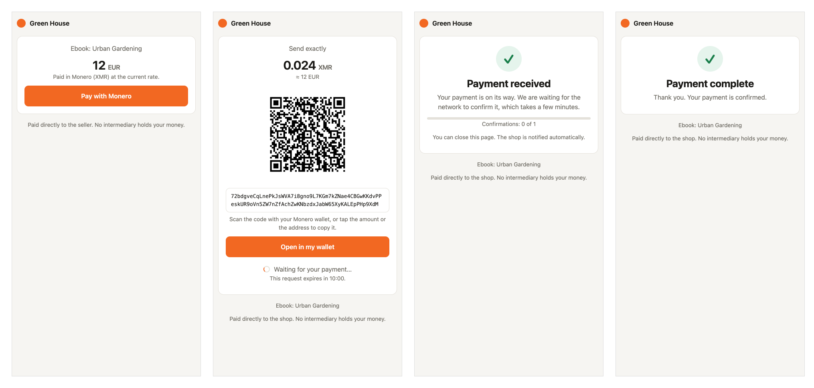
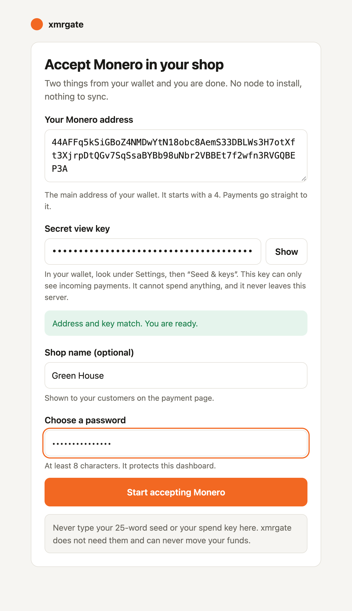
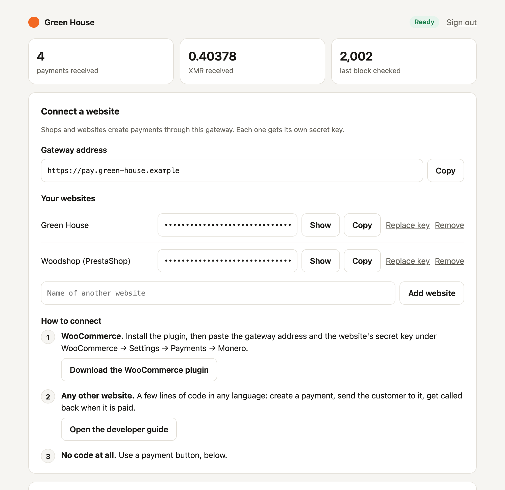
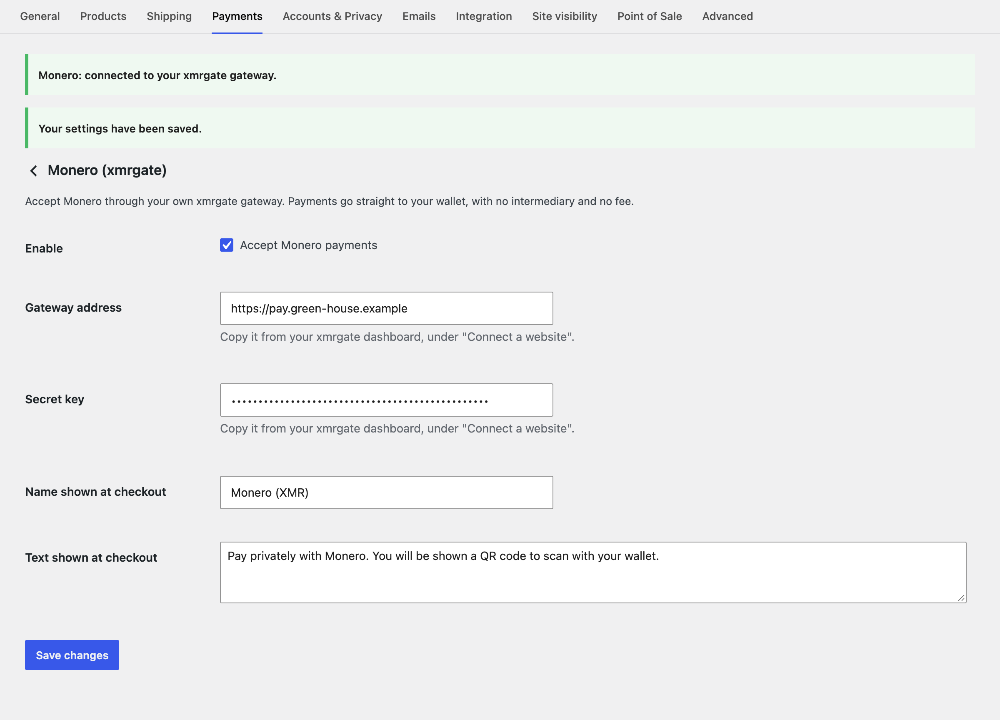
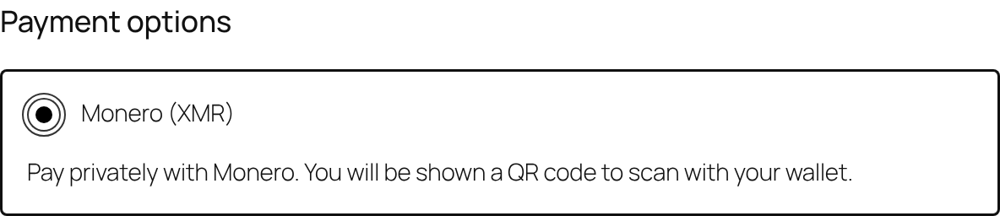
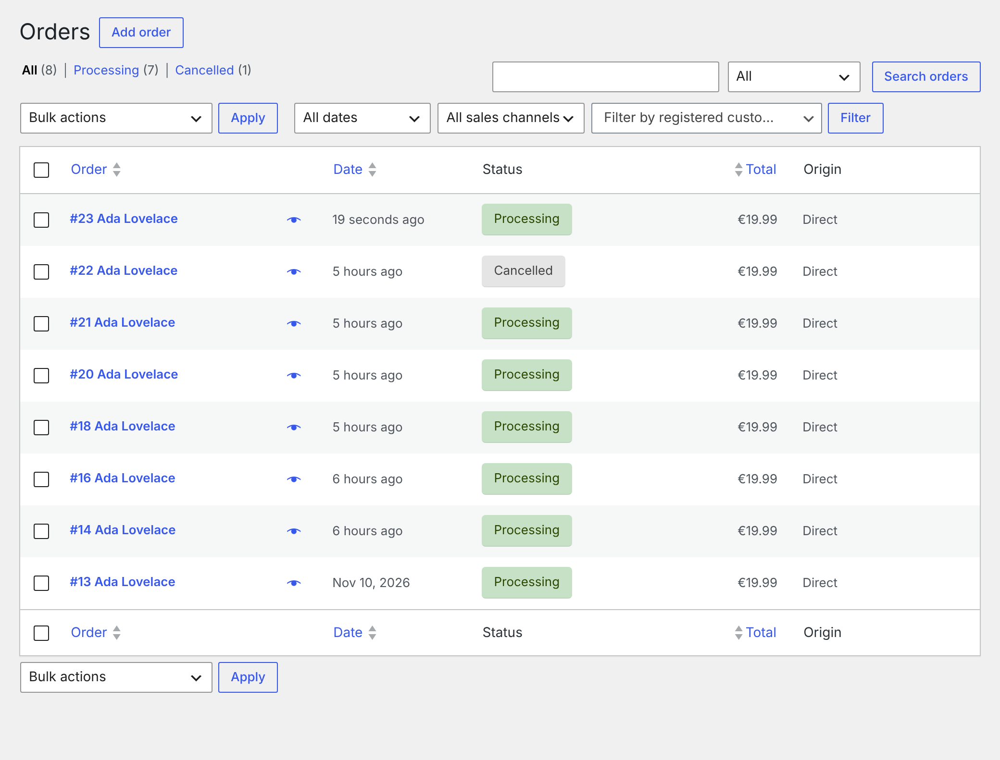
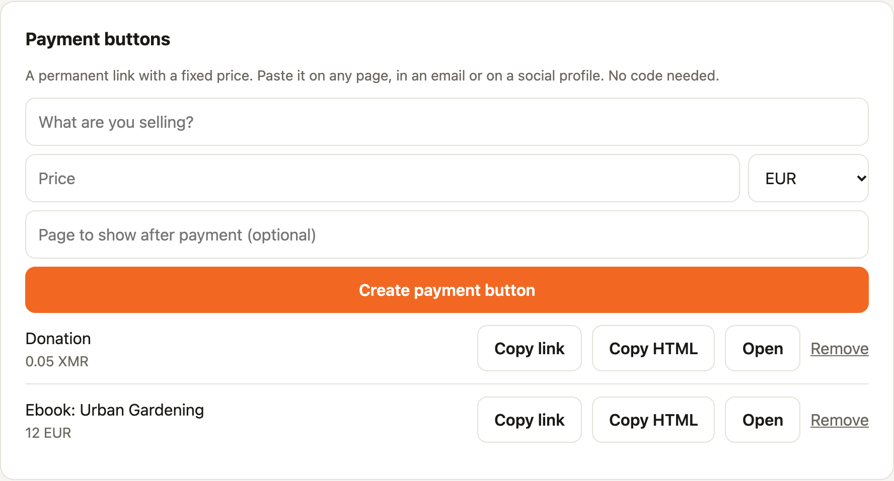
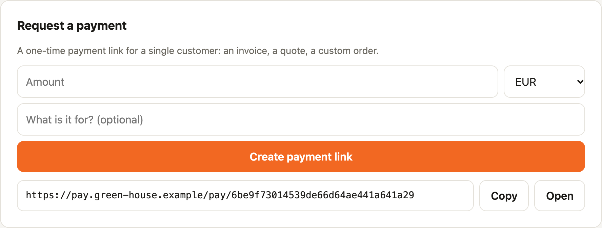
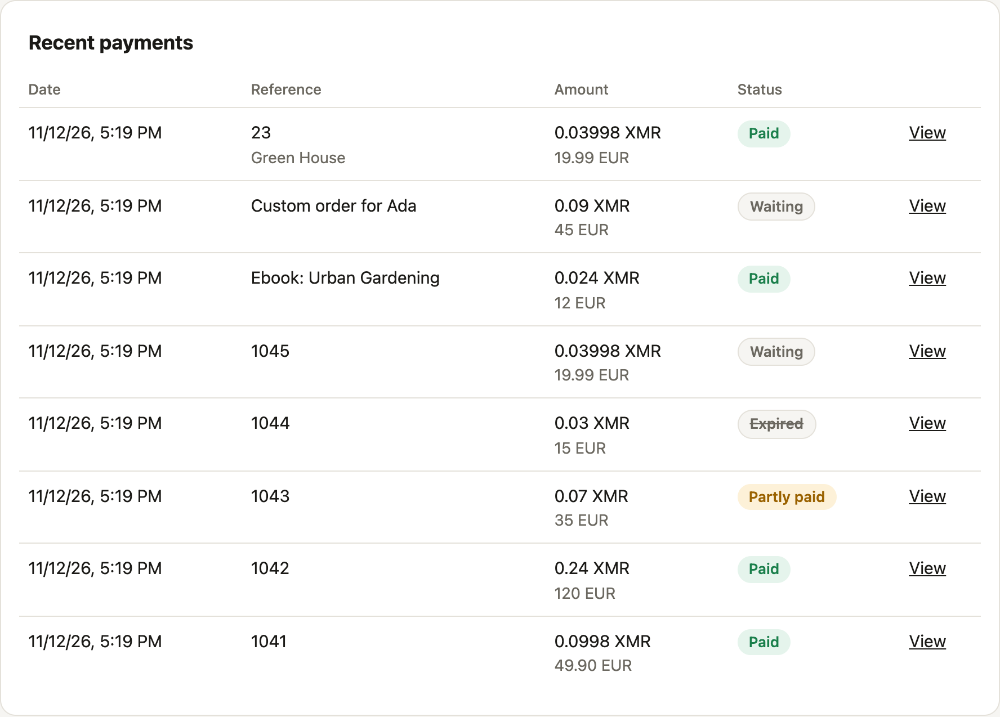
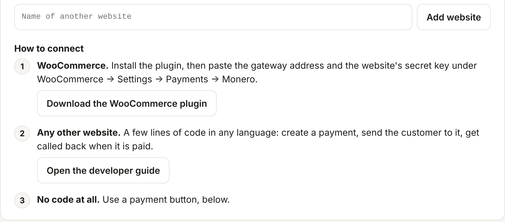

# xmrgate user guide

Accept Monero on any website, paid straight into your own wallet. This guide takes you from
nothing to your first payment. No technical background is needed for most of it.



## Contents

1. [What you need](#1-what-you-need)
2. [Install xmrgate](#2-install-xmrgate)
3. [Set it up (one screen)](#3-set-it-up-one-screen)
4. [Your dashboard](#4-your-dashboard)
5. [Get paid: five ways](#5-get-paid-five-ways)
   - [A WooCommerce shop](#a-a-woocommerce-shop)
   - [A PrestaShop store](#b-a-prestashop-store)
   - [A payment button (no code)](#c-a-payment-button-no-code)
   - [A one-time payment link](#d-a-one-time-payment-link)
   - [Any other website](#e-any-other-website)
6. [What your customer sees](#6-what-your-customer-sees)
7. [Follow your payments](#7-follow-your-payments)
8. [Settings](#8-settings)
9. [Looking after your gateway](#9-looking-after-your-gateway)
10. [Questions and problems](#10-questions-and-problems)

---

## 1. What you need

| | |
|---|---|
| **A Monero wallet** | Any wallet where you hold the keys. xmrgate needs two things from it: your **address** and your **secret view key**. |
| **A small server** | The cheapest VPS is plenty: xmrgate uses about 12 MB of memory and a few megabytes of disk. It does not download the Monero blockchain. |
| **A domain name** | For example `pay.yourshop.com`, pointed at that server. Your customers' browsers need a secure (`https`) address. |
| **About ten minutes** | |

> **Is it safe to give my view key?**
> The secret view key can only *see* incoming payments. It cannot spend anything. It is stored
> on your own server and is never sent anywhere. xmrgate never asks for your 25-word seed or
> your spend key. If a page ever asks for those, close it.

---

## 2. Install xmrgate

### The easy way: Docker

On your server, with [Docker](https://docs.docker.com/engine/install/) installed:

```bash
git clone https://github.com/nowi333/xmrgate.git
```

```bash
cd xmrgate
```

```bash
XMRGATE_DOMAIN=pay.yourshop.com docker compose up -d
```

Replace `pay.yourshop.com` with your own domain name. This starts xmrgate and a small web
server (Caddy) that obtains and renews the `https` certificate on its own.

Now ask xmrgate for your setup address:

```bash
docker compose logs xmrgate
```

You will see something like this:

```
First run. To finish the setup, open this page on your gateway's own address:

  https://YOUR-DOMAIN/setup?code=3f9a1c2b7d4e5f60
```

Open that address in your browser, with your own domain in place of `YOUR-DOMAIN`. The code is
there so that only you can do the setup.

### Without Docker

You need the [Rust toolchain](https://rustup.rs).

```bash
cargo build --release
```

```bash
./target/release/xmrgate
```

xmrgate then listens on `http://127.0.0.1:3080` and prints the setup address. Put a web server
that provides `https` in front of it before sharing the address with customers.

---

## 3. Set it up (one screen)



**Your Monero address.** The main address of your wallet. It starts with a `4`.

**Secret view key.** In the official Monero wallet, open **Settings → Seed & keys** and copy
the **secret view key**. Other wallets have a similar screen, usually called *Keys*.

As soon as both are pasted, xmrgate checks that they belong together and tells you:

- *"Address and key match. You are ready."* Everything is right.
- *"This view key belongs to another wallet."* The address and the key were copied from two
  different wallets.
- *"This is a subaddress…"* You pasted an address starting with `8`. Use the main one.

**Shop name.** Optional. Your customers see it on the payment page.

**Password.** Protects your dashboard. Choose a long one.

Press **Start accepting Monero**. That is the whole installation.

---

## 4. Your dashboard



The badge at the top right tells you how things are going:

| Badge | Meaning |
|---|---|
| **Ready** | Everything works. |
| **Catching up** | xmrgate was off for a while and is reading the blocks it missed. Recent payments appear a little later. |
| **Needs attention** | Something stops payments from being detected. A message below the header says what, and what to do. |

The three numbers show how many payments you received, how much, and the last block of the
Monero network that xmrgate checked. While nobody is paying, xmrgate rests and downloads
nothing.

---

## 5. Get paid: five ways

### A. A WooCommerce shop

> **Prefer to watch?** The [video tutorial](video/woocommerce-tutorial.mp4) (3:43) walks through
> this whole section, from installing xmrgate to the first paid order.

1. In the dashboard, under **Connect a website**, click **Download the WooCommerce plugin**.
2. In WordPress, go to **Plugins → Add new → Upload plugin**, choose the file you just
   downloaded, and activate it.
3. Go to **WooCommerce → Settings → Payments → Monero (xmrgate)**.
4. Paste the **gateway address** and your website's **secret key**, both shown in the
   dashboard. Use the **Copy** buttons to avoid typos.
5. Press **Save changes**.



WooCommerce tells you immediately whether it worked. *"Connected to your xmrgate gateway"*
means you are done. If the key is wrong or the address cannot be reached, it says which.

**Optional: a discount or a fee for Monero.** In the same settings, **Discount or fee (%)**
changes the price for customers who pay with Monero. Enter `-5` to give 5% off, or `2` to add
a 2% fee; `0` means neither. It is calculated on the products and shipping, before tax. It shows
as its own line (*"Monero discount (5%)"*) in the checkout, the order and the emails, and the
checkout text tells the customer about it.

Your customers now see Monero at checkout:



Orders update on their own:

| What happened | Order status in WooCommerce |
|---|---|
| The customer's payment was detected | **On hold** |
| The payment is confirmed | **Processing** (or **Completed** for downloads) |
| The customer paid only part of it | **On hold**, with a note saying how much is missing |
| Nobody paid in time | **Cancelled** |



### B. A PrestaShop store

1. In the dashboard, under **Connect a website**, click **Download the PrestaShop module**.
2. In PrestaShop, go to **Modules → Module Manager → Upload a module** and choose the file you
   just downloaded.
3. Click **Configure** on the module.
4. Paste the **gateway address** and your website's **secret key**, both shown in the
   dashboard, then press **Save**.

PrestaShop tells you immediately whether it worked. *"Connected to your xmrgate gateway"*
means you are done: **Monero (XMR)** now appears among the payment methods at checkout.

Orders update on their own:

| What happened | Order status in PrestaShop |
|---|---|
| The customer chose Monero | **Awaiting Monero payment** |
| The customer's payment was detected | **Monero payment detected, confirming** |
| The payment is confirmed | **Payment accepted**, with the xmrgate invoice as transaction ID |
| The customer paid only part of it | **Monero payment incomplete** |
| Nobody paid in time | **Canceled** |

The module works with PrestaShop 1.7.7 and later, including 8 and 9.

### C. A payment button (no code)

A payment button is a permanent link with a fixed price. Use it to sell one thing, take
donations, or get paid from a page you cannot add code to.



1. Under **Payment buttons**, say what you are selling and its price.
2. Optionally give the page your customer should land on after paying, for example a download
   page.
3. Press **Create payment button**.

Then either:

- **Copy link** and paste it anywhere: a web page, an email, a social profile, a QR code on a
  flyer.
- **Copy HTML** and paste it into your website's code. It is a plain link that says
  "Pay with Monero".

Each person who presses the button gets their own payment page and their own payment address.

### D. A one-time payment link

For a single customer: an invoice, a quote, a custom order.



Under **Request a payment**, type the amount, choose the currency, add a short description,
and press **Create payment link**. Send the link to your customer. It works once and expires
after 10 minutes unless you change that in the settings.

### E. Any other website

Any website that can run a little code can use xmrgate: a custom shop, a booking
system, a membership site.

Your gateway includes a developer guide at **`https://your-gateway/docs`**, also linked from
the dashboard. It explains the three steps (create a payment, send the customer to it, get
called back when it is paid) and contains complete, tested examples in **PHP**, **Node.js**
and **Python**. The same examples are in [`examples/integrations`](../examples/integrations).

**Several websites?** Under **Connect a website**, type a name and press **Add website**. Each
website gets its own secret key and only sees its own payments. If a key leaks, press
**Replace key** for that website; the others are not affected.

---

## 6. What your customer sees


1. **The price.** Only for payment buttons. Shops skip this step.
2. **The payment page.** The exact amount in Monero, a QR code, and the address. On a phone,
   **Open in my wallet** opens their Monero app with everything filled in.
3. **Payment received.** Shown a few seconds after they pay. They can close the page.
4. **Payment complete.** Shown once the network has confirmed the payment, usually within a few
   minutes. They are then sent back to your site.

Two special cases are handled for you:

- **They sent too little.** The page says how much arrived and how much is missing, with a new
  QR code for the rest.
- **They ran out of time.** The page tells them not to pay any more and to start again from
  your site. If a payment still arrives within the next 24 hours, it is credited.

---

## 7. Follow your payments



| Status | Meaning |
|---|---|
| **Waiting** | The customer has not paid yet. |
| **Confirming** | The full amount was detected and is being confirmed by the network. |
| **Paid** | Confirmed. The money is in your wallet. |
| **Partly paid** | Some money arrived, but less than the price. |
| **Expired** | Time ran out and nothing was received. |

**View** opens the payment page exactly as the customer sees it.

Under each reference, a small line says where the payment came from: the website or the
payment button.

To spend what you received, simply open your own Monero wallet. xmrgate never holds your
money.

---

## 8. Settings



Open **Settings** at the bottom of the dashboard.

| Setting | What it does | Good value |
|---|---|---|
| **Confirmations** | How many network confirmations before a payment counts as paid. | `1` for everyday amounts (about 2 minutes). `10` for large amounts. |
| **Minutes to pay** | How long a customer has before a payment request expires. | `10` |
| **Public address** | Only if customers reach the gateway through a different address than you do. | Empty |
| **Monero nodes** | The public servers xmrgate reads the blockchain from. | At least two that answer |
| **Tor proxy** | Hides your server's address from the nodes. Needs Tor running on the server. | Empty unless you use Tor |

**About nodes.** xmrgate does not trust any single node. It compares them, and accepts a block
only when two agree on it. That is why it needs at least two working nodes. Each node in the
list has a light: green means it answers and agrees with the others. To add one, paste its
address, press **Add** (xmrgate tests it first), then **Save**.

---

## 9. Looking after your gateway

### Back up

Everything xmrgate knows is in one small folder. Copy it somewhere safe from time to time:

```bash
docker compose cp xmrgate:/data ./xmrgate-backup
```

Without Docker, copy the `xmrgate-data` folder.

Keep that copy private: it contains your view key. Losing it never loses money, because your
funds are in your wallet, not in xmrgate.

### Update

```bash
git pull
```

```bash
XMRGATE_DOMAIN=pay.yourshop.com docker compose up -d --build
```

Your settings and payment history are kept.

### Forgotten password

Stop xmrgate, choose a new password, start it again:

```bash
docker compose stop xmrgate
```

```bash
docker compose run --rm --no-deps xmrgate xmrgate --reset-password
```

```bash
docker compose start xmrgate
```

Without Docker: stop xmrgate, run `./target/release/xmrgate --reset-password`, start it again.

---

## 10. Questions and problems

**The dashboard says "Fewer than two nodes are answering".**
Public nodes come and go. Open **Settings → Monero nodes**, remove the ones with a red light,
and add working ones. Payments are not lost in the meantime: xmrgate catches up as soon as two
nodes answer again.

**A customer says they paid, but the order is still waiting.**
Open the payment with **View**. If it says *Payment received*, it is simply waiting for
confirmation. If it still asks for payment, ask the customer for the address they paid to and
compare it with the one on that page. The **Activity log** at the bottom of the
dashboard can help too: it notes payments that arrived on an address no longer in use.

**A customer paid too little.**
The payment shows as **Partly paid**. They can send the rest to the same address, and it
completes on its own. Otherwise, refund them from your wallet.

**How do I refund someone?**
From your own Monero wallet, to an address the customer gives you. xmrgate cannot send money,
which is also why it cannot lose any.

**I received payments but my wallet does not show them all.**
Every payment uses its own subaddress of your wallet. Wallets only look a certain number of
subaddresses ahead (200 by default in the official wallet). xmrgate reuses the addresses of
unpaid requests to stay well within that, so this only happens to very busy shops. If it does,
raise the *subaddress lookahead* in your wallet and let it rescan. The funds are there.

**Can I try it without real money?**
Yes. Monero has a test network called *stagenet*. Create a stagenet wallet, and paste its
address (it starts with a `5`) and view key in the setup. xmrgate notices and uses the test
network. Developers can also run `cargo run --example demo` to explore every screen on a
simulated network.

**The dashboard says "Update required".**
The Monero network was upgraded to a version this xmrgate cannot read. Update xmrgate as
described above. Payments made in the meantime are found once it is updated and back in sync.

**Is xmrgate a company? Are there fees?**
No and no. It is free, open-source software that you run yourself. Customers pay you directly.

**Something else is wrong.**
The **Activity log** at the bottom of the dashboard records what xmrgate noticed. With Docker,
`docker compose logs xmrgate` shows whether it is running.
